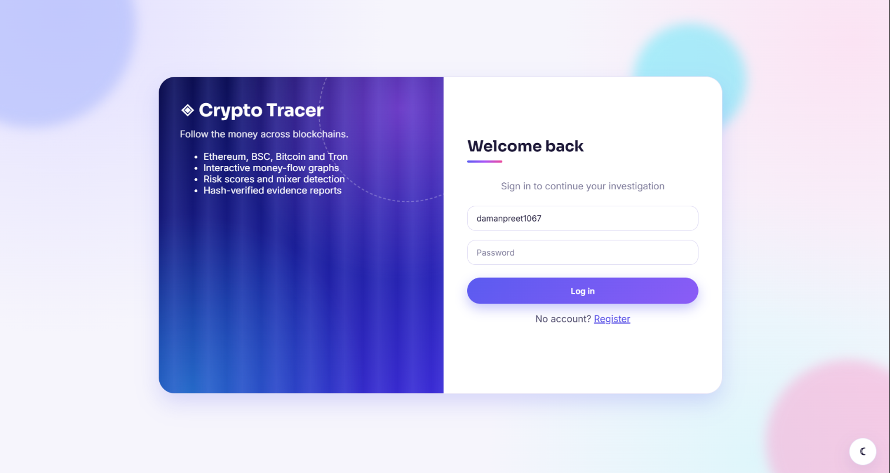
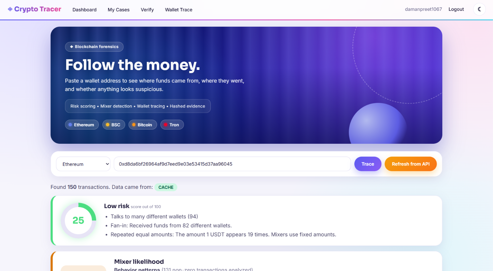
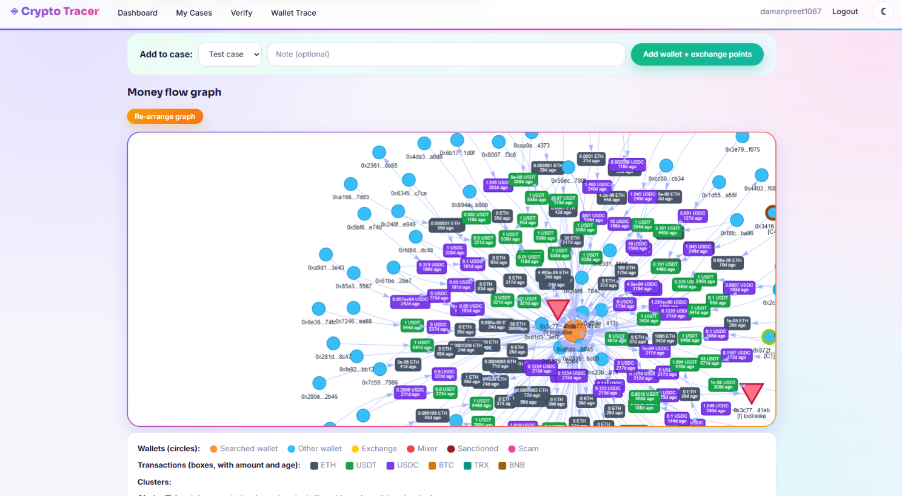
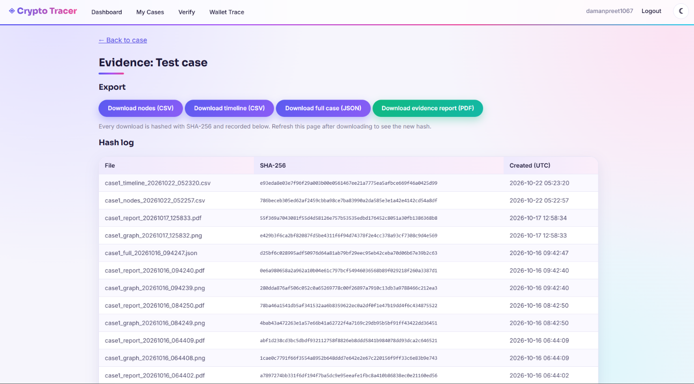

# Crypto Transaction Tracer

A blockchain forensics dashboard. Trace a wallet across Ethereum, BSC, Bitcoin and
Tron, see the money flow as a graph, get an explainable risk assessment, and export
evidence files that can be verified with SHA-256 hashes.
## Screenshots

## Features
- Login and register (bcrypt-hashed passwords), with per-user cases
- Four chains: Ethereum, BSC, Bitcoin, Tron
- Tokens: USDT and USDC (Ethereum, BSC), USDT (Tron)
- NetworkX money-flow graph: wallet nodes, transaction nodes with amount and age
- AML labels, risk score with written reasons, behavior patterns, mixer likelihood
- Wallet clustering and an address-poisoning detector
- Wallet-to-wallet tracer: follow money hop by hop, or search for a path from A to B
- Cases: exchange endpoints are saved as case nodes
- Evidence: CSV, JSON and PDF exports, a UTC timeline, a SHA-256 hash log
- Tamper checker: upload an exported file to see whether it was modified
- SQLite cache: each wallet is fetched from an API only once (no rate limits)
- Light and dark themes

## Setup
1. Install Python 3.12 or 3.13.
2. Create and activate a virtual environment:
   `python -m venv venv` then `venv\Scripts\activate` (Windows)
   or `source venv/bin/activate` (Mac/Linux)
3. `pip install -r requirements.txt`
4. Copy `config_example.py` to `config.py` and add your API keys:
   Etherscan (Ethereum), MegaNode (BSC), TronGrid (optional).
5. `python app.py`, then open http://127.0.0.1:5000

## Limitations
- Risk scores, behavior patterns and clusters are indicators, not proof.
- The label list in `data/labels.json` is small and should be verified before use.
- Only the 50 newest records per source are read for each wallet.
- Bitcoin transactions with several senders use the first sender.
- Monero and other privacy coins cannot be traced from public data.
- Built for local demonstration: debug mode is on and there is no CSRF protection.

## Disclaimer
Educational project. Results are not legal or financial advice.